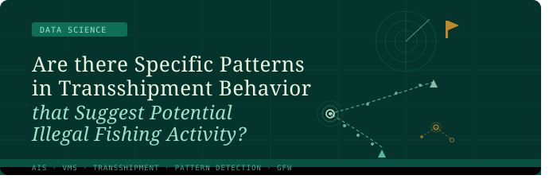

# Does Vessel Behavior (speed, duration, time of day) Suggest Potential Illegal Fishing Activity When Near Marine Protected Areas?

## Data Used

### Transshipment Data

- *Source*: [Miller et al. (2018). Identifying Global Patterns of Transshipment Behavior, Global Fishing Watch](https://globalfishingwatch.org/data-download/datasets/public-miller-frontiers-marine-science-2018), Accessed 31 March 2026
  - *Note*: Free account required to access
- *Version*: 1.0, updated 8/4/2025
- *License*: Copyright Global Fishing Watch. Licensed under CC BY-NC 4.0
- *Citation*: Miller, N. A., Roan, A., Hochberg, T., Amos, J., & Kroodsma, D. A. (2018). Identifying global patterns of transshipment behavior. Frontiers in Marine Science, 5, 240.

### Global Marine Protected Area Geographic Data

- *Source*: [Marine Protected and Conserved Areas, Protected Planet](https://www.protectedplanet.net/en/thematic-areas/marine-protected-areas), Accessed 5 April 2026
- *Version*: April 2026
- *License*: Non commercial use; Commercial use option available
- *Citation*: UNEP-WCMC and IUCN (2026), Protected Planet: The World Database on Protected Areas (WDPA) and World Database on Other Effective Area-based Conservation Measures (WD-OECM) [Online], April 2026, Cambridge, UK: UNEP-WCMC and IUCN. Available at: [www.protectedplanet.net](www.protectedplanet.com).

## Finding

The most suspicious behavior profile is 'Nighttime Stealth' because of its slow speed and close proximity to marine protected areas during the night. This profile has a statistical significance level of 0.0. 

## Reproduce it

### Prerequisites

- uv (Python package manager)
  - Install using [the official instructions](https://docs.astral.sh/uv/getting-started/installation/)
 
### Steps

1. Clone this repository and enter the directory
2. Run ```uv sync``` to install the required packages
3. Download the transshipment dataset CSVs from Global Fishing Watch and the Global Marine Protected Area geodatabase from Protected Planet using the links in *Data Used*, or download the specific version of data used from the project's [Google Drive](https://drive.google.com/drive/folders/10qWARZB0qvDnfMljp5OKzUKdPxeiNNIr?usp=drive_link)
4. Store the transshipment CSVs in data/raw/transshipments, and the WDPA_WDOECM_Apr2026_Public_marine.gdb geodatabase in data/raw/global_mpa
5. Run ```uv run jupyter lab``` to start Jupyter Lab
6. Execute each notebook in the notebooks/ directory from the top cell in order of their number (0_EDA.ipynb, then 1_Engineering.ipynb, etc.)

## Big Idea

Our project uses machine learning to find fishing patterns that traditional surveillance might miss. By analyzing how long ships stay in one place and whether they prefer to operate during night, we grouped thousands of vessels into behavioral categories. We discovered a specific group of ships that consistently lingers near marine protected areas specifically at night. This insight can help identify potential illegal fishing. By identifying these high-risk behaviors globally, we provide a tool that helps authorities prioritize which vessels to investigate in vast, hard-to-police waters.

## Limitations

- We are using a 'historical' dataset from 2017 that may not accurately reflect the present or the recent changes in marine fishing regulation
- We use a linear dimensionality technique to reduce dataset features. Does not take into account non-linear relationships
- We are not claiming these ships are doing illegal activities. We are suggesting suspicious activity because of the proximity to MPAs and other conditions such as nighttime and duration
- The dataset was curated with AI models. The research group claimed they were not 100% accurate. There could be errors in lat/long calculations. 
